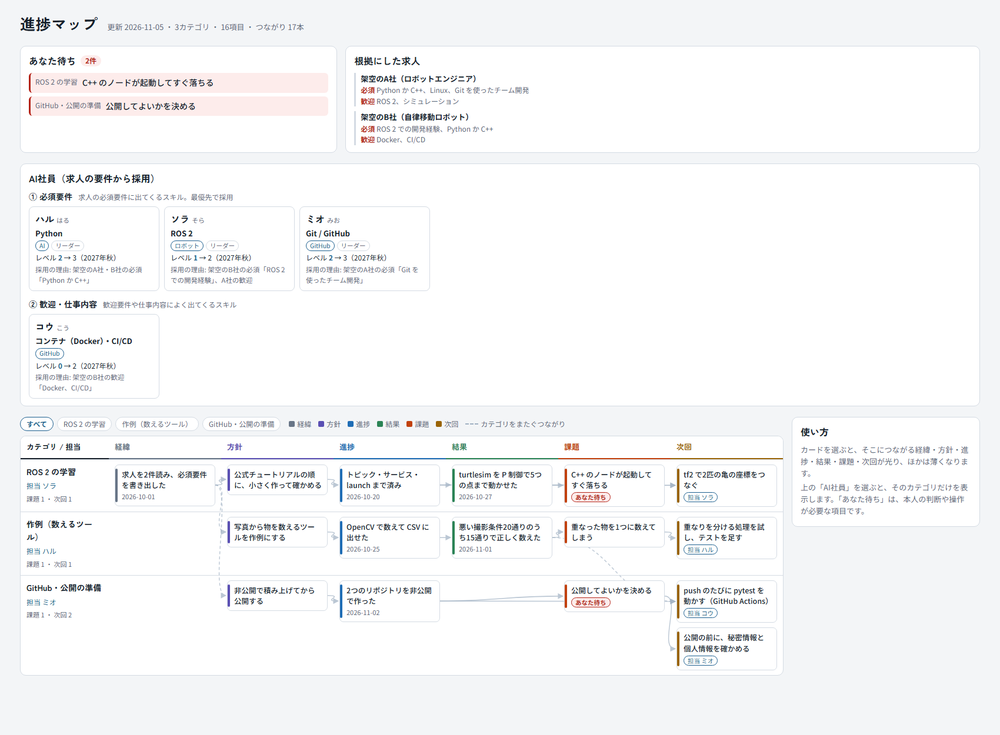

# AI社員と進捗マップのテンプレ

> Hire Claude Code subagents as "AI staff" from job-posting requirements, and track their work on a one-page progress map (JSON + HTML, Japanese).

## 何ができるか

- Claude Code の**サブエージェント**を、求人の要件から「AI社員」として採用し、1つのスキルに1人ずつ担当を決められます
- 担当の報告（経緯・方針・進捗・結果・課題・次回）を JSON に足すと、つながりが線で見える**進捗マップ**のページが1枚できます
- 「あなた待ち」（本人の判断や操作が要る項目）と、根拠にした求人・採用した担当が、同じページの上に並びます



中身はすべて見本（架空の人と架空の求人）です。【】の中や見本の値を、自分の内容に書き換えて使ってください。

## 使い方（3手順）

1. `progress-map/map.json` を書き換える（まずは見本のまま次へ進んでもよい）
2. `build.ps1` を実行する
   ```powershell
   powershell -ExecutionPolicy Bypass -File .\progress-map\build.ps1
   ```
3. できた `progress-map/index.html` をブラウザで開く

AI社員として使うには、`agents/*.md` を Claude Code のエージェントの置き場所に置きます（下の「置き場所」）。

## フォルダの中身

```
ai-staff-template/
├── agents/
│   ├── haru.md            見本: ハル（Python、① 必須、AI 領域のリーダー）
│   ├── sora.md            見本: ソラ（ROS 2、① 必須、ロボット領域のリーダー）
│   ├── mio.md             見本: ミオ（Git / GitHub、① 必須、GitHub 領域のリーダー）
│   ├── kou.md             見本: コウ（Docker・CI/CD、② 歓迎）
│   └── _common-rules.md   共通のきまりと、新しい担当のひな形（エージェントではない）
├── progress-map/
│   ├── map.json           データ（見本: 3カテゴリ・16項目）
│   ├── template.html      ページのひな形（ふつうは触らない）
│   └── build.ps1          map.json を template.html に埋め込んで index.html を作る
├── docs/
│   └── screenshot.png     見本のページの画像
├── README.md
├── PUBLISH_CHECKLIST.md   このテンプレを公開する前に確かめたこと
└── LICENSE                MIT
```

## はじめかた

1. このフォルダを好きな場所に置く（例: `~/ai-staff`）
2. 進捗マップの見本を作ってみる（下の「進捗マップを作る」）。ブラウザで `progress-map/index.html` を開くと、どんなものかが分かります
3. 求人を集めて、AI社員を決める（下の「AI社員の作り方」）
4. `agents/` の見本を書き換えて、Claude Code のエージェントの置き場所にコピーする（下の「置き場所」）
5. Claude Code を開き直し、「ハルに、〜を頼んで」のように頼む
6. 担当の報告を `map.json` に足して、`build.ps1` を実行する

## AI社員の作り方

### 1. 求人を集める
行きたい職種の求人を3〜5件集め、要件を「必須」「歓迎」「仕事内容」に分けて書き出します。社名は自分のメモの中だけにしておけば十分です。

### 2. 採用の順番
| 優先度 | どこから採るか | 見本 |
|---|---|---|
| **① 必須要件** | 必須要件に出てくるスキル。何件もの求人に出てくるものから先に | ハル（Python）、ソラ（ROS 2）、ミオ（Git / GitHub） |
| **② 歓迎・仕事内容** | 歓迎要件や仕事内容によく出てくるスキル | コウ（Docker・CI/CD） |
| **③ 独自テーマ** | 求人には少なくても、自分の強みややりたいこと（ほかの人と差がつくところ） | （見本なし。例: 画像処理、機械学習、起業のテーマ） |

- **1つのスキルに1人。** 担当がはっきりすると、頼み方も報告も迷いません
- **領域ごとにリーダーを1人。** 領域（例: AI・ロボット・GitHub）の中の順番を決め、新しい担当の採用を提案します
- **最初は3〜4人で十分。** 新しい求人を見つけたら必須要件と名簿を照らし、足りないスキルの担当を採用します

### 3. 定義ファイルを書く
`agents/haru.md` をコピーして書き換えるのがいちばん早いです。形は次のとおりです。

| 部分 | 書くこと |
|---|---|
| `name` | 英小文字の ID（ファイル名と同じにする） |
| `description` | 「何を任せるときに使うか」。Claude はここを読んで担当を選ぶので、作業の名前を具体的に並べる |
| 1段落目 | 名前・領域・履歴書のスキル・受け持ち（リポジトリやフォルダ）・今の実績とレベル・進め方 |
| 共通のきまり | `agents/_common-rules.md` の節をそのまま貼る（全員同じ） |
| 採用の理由（求人票） | 優先度・どの求人のどの要件か・入社日・仕事のしかた |

独自テーマの担当なら、採用の理由は次のように書きます。

```markdown
## 採用の理由（求人票）
- 採用の優先度: ③ 独自テーマ
- 理由: 自分の強み（画像処理）。求人の必須には少ないが、認識の仕事でほかの人と差がつく
```

**レベルの目安**（見本で使っている物差し）

| レベル | 状態 |
|---|---|
| 0 | 触ったことがない |
| 1 | 手順を見ながら動かせる |
| 2 | 自分で小さく作れる（使える） |
| 3 | 仕事で任せられる |
| 4 | 人に教えられる・設計を決められる |

### 4. 共通のきまり
全員に同じきまりを書いておくと、報告の形と安全の線引きがそろいます。見本のきまりは次のとおりです。

- 報告は日本語。英語の文章（OSS の Issue や PR）は日本語訳つきの下書きにする
- インストール・課金・push・公開・外部サービスへの登録は自分で実行せず、「承認が要る」と返す
- 勤め先の業務データ・コード・社内情報は使わない
- 秘密鍵・トークン・パスワードを Git に入れない
- 実行していないテストを「成功」と書かない
- 最後に **経緯・方針・進捗・結果・課題・次回** の6つで報告する（そのまま進捗マップに足せる）

サブエージェントはほかのファイルを読み込まないので、きまりは各ファイルに書きます。変えるときは `_common-rules.md` を直してから、全員のファイルの同じ節を置き換えてください。

## 置き場所（Claude Code のサブエージェント）

| 置き場所 | 使える範囲 |
|---|---|
| `~/.claude/agents/`（Windows は `C:\Users\<ユーザー名>\.claude\agents\`） | 自分の PC のすべてのプロジェクト |
| プロジェクトの `.claude/agents/` | そのプロジェクトだけ。Git に入れればチームで共有できる |

同じ名前の担当が両方にあるときは、プロジェクトのほうが使われます。`_common-rules.md` はエージェントではないので、コピーしないでください。

```powershell
# Windows（PowerShell）
New-Item -ItemType Directory -Force "$HOME\.claude\agents" | Out-Null
Get-ChildItem .\agents\*.md -Exclude _* | Copy-Item -Destination "$HOME\.claude\agents\"
```

```bash
# macOS / Linux
mkdir -p ~/.claude/agents && cp agents/[!_]*.md ~/.claude/agents/
```

置いたら Claude Code を開き直し、`/agents` で一覧に出ているかを確かめます。

### 頼み方と「統括」
- 「ソラに、tf2 のチュートリアルを進めてもらって」「ハルとミオで、ツールにテストを足してコミットまで」のように名前で頼みます。名前を出さなくても、`description` に合う仕事なら Claude が担当を選びます
- 担当に割り振り、報告をまとめ、進捗マップを更新するのは、いつも話している Claude（このテンプレでは「**統括**」と呼びます）です
- 統括に役割を覚えてもらうには、`CLAUDE.md`（プロジェクトの直下か `~/.claude/CLAUDE.md`）に次のように書いておきます

```markdown
## AI社員
- 担当の定義は ~/.claude/agents/ にある（haru・sora・mio・kou）。頼まれた仕事は、合う担当に割り振る
- 担当の報告（経緯・方針・進捗・結果・課題・次回）を ~/ai-staff/progress-map/map.json に足し、build.ps1 を実行する
- 本人の判断や操作が要るものは、項目に "waiting": "本人" を付ける
```

## 進捗マップ

### 進捗マップを作る
```powershell
# Windows
powershell -ExecutionPolicy Bypass -File .\progress-map\build.ps1
# PowerShell 7 があれば
pwsh -File .\progress-map\build.ps1
```
macOS / Linux は PowerShell 7（`pwsh`）で `pwsh progress-map/build.ps1` を実行します。

`progress-map/index.html` ができるので、ブラウザで開きます。`map.json` が JSON として壊れているときは、`build.ps1` がエラーで止まり、index.html は作られません。

### 画面の見方
- 横は左から **経緯 → 方針 → 進捗 → 結果 → 課題 → 次回**、縦はカテゴリ。線は「これがあったから、これをした」のつながり（カテゴリをまたぐ線は点線）
- カードを選ぶと、つながる前後がすべて光ります
- 「あなた待ち」は、本人の判断や操作が要る項目の一覧です
- 「AI社員」を選ぶと、その担当のカテゴリだけを表示します

### map.json の形
| キー | 中身 |
|---|---|
| `updated` | 更新日 |
| `types` | 列の名前。`["経緯","方針","進捗","結果","課題","次回"]` のまま使う（色は並び順で決まる） |
| `staff` | AI社員。`id`（エージェントの name と同じ）・`name`・`kana`・`domain`・`skill`・`lead`・`now`・`goal`・`resume`（今、履歴書に書けること）・`tier`（`must` / `want` / `own`）・`reason`・`hired` |
| `categories` | 地図の行。`id`・`name`・`owner`（担当の id か `"統括"`） |
| `nodes` | カード。下の表 |
| `links` | つながり。`["前の id", "後の id"]` の組の並び |
| `domains` | 領域。`id`・`name`・`lead` |
| `tiers` | 採用の優先度の見出し。`must` / `want` / `own` |
| `postings` | 根拠にした求人。`name`・`must`・`want` |

**カード（nodes）**
| キー | 中身 |
|---|---|
| `id` | 重ならない ID（例: カテゴリの頭文字 + 種類 + 番号 → `r-i1`） |
| `cat` | カテゴリの id |
| `type` | `types` のどれか |
| `title` | 1文で |
| `date` | あれば（経緯・進捗・結果に付けるとよい） |
| `detail` | 数字や理由など |
| `ref` | 元の記録の場所（ファイルや URL） |
| `who` | やる人。担当の id か `"本人"` / `"統括"`（次回に付けるとよい） |
| `waiting` | `"本人"` にすると「あなた待ち」に出る |

### 更新のしかた
1. 担当が「経緯・方針・進捗・結果・課題・次回」で報告する
2. 統括（または自分）が、それぞれを `nodes` に1枚ずつ足し、`links` でつなぐ。終わった「次回」は「進捗」や「結果」に書き換える
3. `updated` の日付を変えて、`build.ps1` を実行する
4. `index.html` を開き直す

### 注意
- `index.html` は毎回作り直すので、Git には入れていません（`.gitignore`）。直すのは `map.json` か `template.html` です
- レベルの目標の時期「2027年秋」は `template.html` の2か所に書いてあります。自分の時期に置き換えてください
- `template.html` は Google Fonts を読み込みます。ネットにつながっていないときは、PC のフォントで表示されます
- `build.ps1` は BOM つきの UTF-8 で保存しています（Windows PowerShell 5.1 が日本語を正しく読むため）。書き換えるときも BOM を残してください
- `detail` などに `</script>` という文字を書くと、ページが壊れます

## 公開するとき
自分用に書き換えた定義や map.json には、名前・勤め先・リポジトリ・PC のユーザー名（`C:\Users\...` のパス）が入りがちです。公開する前に全ファイルと `git log` を確かめ、コミットのメールは GitHub の noreply アドレスにしてください。このテンプレ自体を公開する前に確かめたことは `PUBLISH_CHECKLIST.md` にあります。

## ライセンス
MIT（`LICENSE` を参照）。自由に使い、書き換え、再配布できます。

---

English: Hire Claude Code subagents as "AI staff" from job-posting requirements, and track their work on a one-page progress map (JSON + HTML, Japanese). All sample data is fictional. MIT License.
